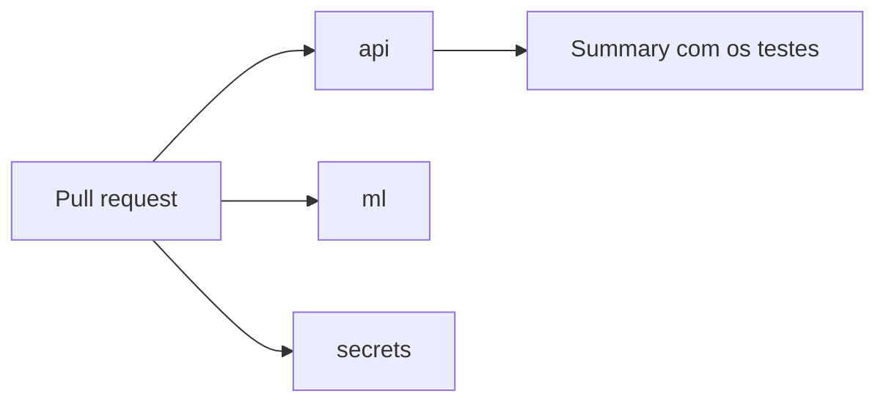

# Changelog

O histórico segue o que já está na `main`. Datas no formato AAAA-MM-DD.

## [Não publicado]

Nada aguardando publicação além do que está na `main`.

## [2026-10-26]

### Adicionado

- CI no GitHub Actions, disparado em pull request e nas branches `develop` e `main`.
- Testes unitários de `parseGamePitch`, o contrato de entrada do `POST /api/report`.
- Resumo da validação na aba Summary do check, com a saída dos testes.
- Modelo de pull request em português (`.github/PULL_REQUEST_TEMPLATE.md`).
- Selos de CI no README.
- Comentário no pull request com a contagem dos testes de `parseGamePitch` e se o contrato de `POST /api/report` foi exercitado.
- Um workflow só (`ci.yml`) desenha o pipeline `api`, `ml`, `compose` e `secrets`. O job que o diff não toca aparece como não rodou.
- A execução no Actions tem nome legível e a aba Summary é um quadro de passou ou falhou, não um trecho de log.
- A trava de merge em `main` e `develop` está desenhada (`secrets` obrigatório), mas o GitHub não aplica branch protection em repositório privado de organização no plano gratuito.
- Branch `develop`, ao lado de `main`.
- Contrato de ambientes em [`docs/ci-cd.md`](docs/ci-cd.md): DEV, homologação e produção, ainda sem deploy.

### Ajustado

- Dependabot ignora atualização de versão maior e mantém no máximo dois pull requests abertos por ecossistema.

### Validação que o pull request mostra

| Check | Quando roda | O que prova |
|-------|-------------|-------------|
| `api` | mudança em `api/**` | testes do pitch, typecheck, build, audit crítico e imagem Docker |
| `ml` | mudança em `ml-service/**` | 15 testes sintéticos do pipeline, sem Torch |
| `compose` | Compose ou Dockerfiles | o arquivo sobe de configuração, sem buildar o ML |
| `secrets` | todo PR | nenhuma chave nova no histórico do Git |

### Ainda fora desta entrega

Deploy em DEV, homologação e produção. Feature flags. Trava de branch protection no GitHub, que é configuração do repositório.
